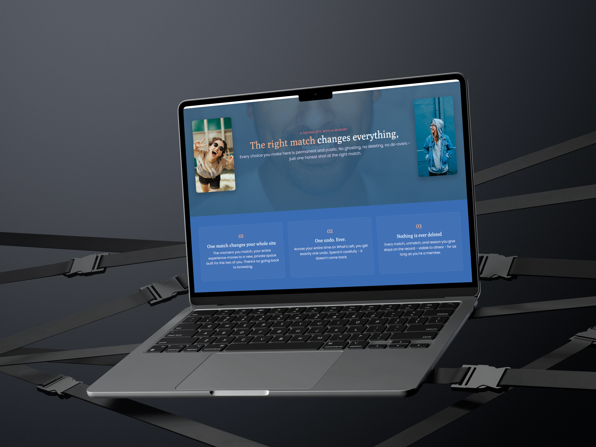

##### Shaun Linde

##### 251208

###### DV200 – SQL and PHP Development, Semester 2

### What's Left

A dating web app with a twist: every decision is permanent and public.

[**Explore the docs »**](#getting-started-xampp)

[View Demo](#-add-your-public-youtubedrive-link-here-before-submitting) · [Report Bug](../../issues) · [Request Feature](../../issues)

## Table of Contents

- [About the Project](#about-the-project)
  * [Project Description](#project-description)
  * [Built With](#built-with)
- [Getting Started](#getting-started)
  * [Prerequisites](#prerequisites)
  * [Installation](#installation)
  * [Demo Data & Login](#demo-data--login)
- [Features and Functionality](#features-and-functionality)
- [Database Design](#database-design)
  * [Entity-Relationship Diagram](#entity-relationship-diagram)
- [Development Process](#development-process)
  * [Implementation Process](#implementation-process)
    + [Highlights](#highlights)
    + [Challenges](#challenges)
  * [Reviews and Testing](#reviews-and-testing)
    + [Feedback from Reviews](#feedback-from-reviews)
    + [Unit Tests](#unit-tests)
  * [Future Implementation](#future-implementation)
- [Final Outcome](#final-outcome)
  * [Video Demonstration](#video-demonstration)
- [Security Notes](#security-notes)
- [Known Limitations](#known-limitations)
- [Project Structure](#project-structure)
- [Roadmap](#roadmap)
- [License](#license)
- [Contact](#contact)
- [Acknowledgements](#acknowledgements)

## About the Project


### Project Description

**What's Left** is a dating web app with one rule that changes everything: every swipe is permanent and public. There's no infinite scroll of matches to reconsider — you get one lifetime "undo" to restore your most recent ended match, one lifetime skip on the discover deck, and every dislike or unmatch has to come with a reason that gets published on a public leaderboard for everyone to see.

Built for **DV200 (Semester 2 – SQL and PHP Development)**, the project's real focus is under the hood: session-based authentication, full CRUD across a relational schema, and a public leaderboard powered by a SQL view built from correlated subqueries.

### Built With

- [PHP 8](https://www.php.net/) — vanilla PHP + PDO, no framework
- [MySQL / MariaDB](https://www.mysql.com/) — relational database, prepared statements throughout
- [Apache](https://httpd.apache.org/) (via XAMPP) — web server
- [Bootstrap 5.3](https://getbootstrap.com/) — layout and components
- Vanilla JavaScript (`fetch`) — discover, chat, and profile interactions

## Getting Started

The following instructions will get you a copy of the project up and running on your local machine using XAMPP.

### Prerequisites

Ensure you have [XAMPP](https://www.apachefriends.org/) installed, with Apache and MySQL/MariaDB available.

### Installation

1. **Clone** this repo into your XAMPP `htdocs` folder:

   ```
   git clone https://github.com/Slinde06/https://github.com/Armand-OW/portfolioTemplate-OW.git
   ```

   (or place it directly at `htdocs/whatsleft`)

2. **Start Apache and MySQL** from the XAMPP control panel.

3. **Import the database**:
   - Open phpMyAdmin → *Import* → choose `database/whats_left.sql` → *Go*, **or**
   - From a terminal:
     ```
     mysql -u root -p < database/whats_left.sql
     ```
   - This creates the `whats_left` database, all tables, the `leaderboard_view`, and seeds 24 demo members.

4. **Check the config** — `config/db.php` already points at `localhost` / `whats_left` / user `root` with no password (XAMPP defaults). Update `$DB_USER` / `$DB_PASS` if your setup differs.

5. **Visit** `http://localhost/whats-left/` in your browser. Make sure `uploads/profile_photos/` stays writable by the web server, since uploaded profile photos are served from there.

### Demo Data & Login

The SQL import seeds 24 members (matching the sample photos committed under `uploads/profile_photos/`), a handful of likes/dislikes with public reasons, and two example match states so every screen has something to show immediately:

| What | Where to see it |
|---|---|
| An active match with chat history | Log in as `pieter.naidoo5@example.com`, go to *Match* |
| Two ended matches with public reasons | Visit *Public reasons* on the nav bar |
| General like/dislike activity | Also on *Public reasons* |

**Every seeded account uses the same demo password:** `12345678`
(Any seeded email works — see the `users` table for the full list.)

## Features and Functionality


### Authentication

Signup with validation (age 18+, password confirmation, duplicate-email check), bcrypt password hashing (`password_hash` / `password_verify`), and a session-based login guard (`includes/auth.php`) applied to every page and API endpoint.


### Discover & Swiping

One candidate profile shown at a time. Like, dislike (with a required public reason), or spend your one lifetime "skip" / dislike-undo.


### Matching & Match Space

A mutual like immediately creates a match and moves both users into a shared Match Space; you can't browse again while matched. Match Space includes realtime-feeling chat (short-poll `fetch`) scoped to the active match, plus an unmatch flow that requires a public reason.


### Public Reasons Leaderboard

A public page listing every member's like/dislike/unmatch counts and their most recent unmatch reason — powered by a SQL **view** built from **correlated subqueries** (`leaderboard_view`).


### Profile Management

Up to 6 photos, hobbies (tag input), a 4-axis personality slider set, and bio/location/contact details — all editable and saved via `api/update_profile.php`.

### One-Time Undo

A single lifetime undo that can restore your most recently ended dislike.

## Database Design

### Entity-Relationship Diagram

```mermaid
erDiagram
  USERS ||--o{ USER_PHOTOS : has
  USERS ||--o{ USER_HOBBIES : has
  USERS ||--|| USER_PERSONALITY : has
  USERS ||--o{ SWIPES : "makes as swiper"
  USERS ||--o{ SWIPES : "receives as target"
  USERS ||--o{ MATCHES : "user1"
  USERS ||--o{ MATCHES : "user2"
  MATCHES ||--o{ MESSAGES : contains
  USERS ||--o{ MESSAGES : sends

  USERS {
    int id PK
    varchar first_name
    varchar last_name
    varchar email UK
    varchar password_hash
    date dob
    enum looking_for
    varchar location
    text description
    tinyint is_matched
    int current_match_id FK
    tinyint skip_used
    tinyint undo_used
    tinyint dislike_undo_used
  }
  USER_PHOTOS {
    int id PK
    int user_id FK
    varchar photo_path
    int sort_order
  }
  USER_HOBBIES {
    int id PK
    int user_id FK
    varchar hobby
  }
  USER_PERSONALITY {
    int user_id PK_FK
    tinyint introvert_extrovert
    tinyint analytical_creative
    tinyint tech_savvy
    tinyint sporty
  }
  SWIPES {
    int id PK
    int swiper_id FK
    int target_id FK
    enum action
    varchar reason_short
    text reason_long
    tinyint undone
  }
  MATCHES {
    int id PK
    int user1_id FK
    int user2_id FK
    enum status
    datetime ended_at
    int ended_by FK
    varchar end_reason_short
    text end_reason_long
  }
  MESSAGES {
    int id PK
    int match_id FK
    int sender_id FK
    text message
  }
```

*(GitHub renders the diagram above automatically. A `leaderboard_view` SQL view — not shown as an entity — sits on top of `users`, `swipes` and `matches` using correlated subqueries; see `database/whats_left.sql`.)*

## Development Process

### Implementation Process

- Vanilla PHP + PDO throughout — no framework — to keep the SQL and server-side logic explicit for the DV200 brief.
- Session-based auth guard shared across every protected page and API endpoint.
- Public leaderboard driven by a SQL view using correlated subqueries rather than application-side aggregation.
- Short-poll `fetch` used for chat to simulate realtime behaviour without a websocket server.

### Future Implementation

- Admin/moderation role — currently all posts are auto-approved.
- A real recommendation algorithm for Discover pagination, replacing the current round-robin cursor.

## Final Outcome



### Video Demonstration

> Add your public YouTube/Drive link here before submitting.

## Security Notes

- All queries use PDO prepared statements (`PDO::ATTR_EMULATE_PREPARES => false`) — no raw string-built SQL anywhere in the codebase.
- Passwords are hashed with `password_hash()` / verified with `password_verify()` — never stored or logged in plain text.
- All output is escaped through the `e()` helper (`htmlspecialchars`) before being echoed into HTML, mitigating XSS.
- Session-based auth guard on every protected page and API route; API routes return JSON 401s instead of redirecting.

## Known Limitations

- No admin/moderation role yet — all posts are auto-approved.
- Discover pagination is a simple round-robin cursor, not a recommendation algorithm.
- No automated tests yet.

## Project Structure

```
whats-left/
├── api/                    # JSON endpoints called by the frontend JS (auth-gated)
├── config/
│   └── db.php               # PDO connection + session bootstrap
├── database/
│   └── whats_left.sql       # Full schema, view, and demo seed data (import this)
├── frontend/
│   ├── assets/               # css/js/images
│   └── pages/                 # Every user-facing screen (login, signup, discover, ...)
├── includes/
│   ├── auth.php               # Session guard, included at the top of protected pages
│   ├── functions.php          # Small shared helpers (get_user, photo_url, ...)
│   ├── nav.php / footer.php
├── uploads/profile_photos/   # User-uploaded photos (+ seeded demo photos)
└── index.php                  # Redirects to home/login
```

## Contact

- **Your Name & Surname** — <email@address> — [@instagram_handle](https://www.instagram.com/instagram_handle/)
- **Project Link** — <https://github.com/Slinde06/whatsleft>

## Acknowledgements

- Session/login pattern adapted from: [YouTube](https://www.youtube.com/watch?v=-rMq6PVCd0k)
- Short-poll chat pattern adapted from: [YouTube](https://www.youtube.com/watch?v=57Y9qOj47A4)
- [Bootstrap 5.3](https://getbootstrap.com/) (via CDN) for layout/components
- Google Fonts — Poppins & Poly
- Demo profile photos: Unsplash contributors ayo-ogunseinde, brooke-cagle, christina-wocintechchat-com, ivana-cajina, jeffery-erhunse, joseph-gonzalez, linkedin-sales-solutions, priscilla-du-preez, stefan-stefancik, toa-heftiba